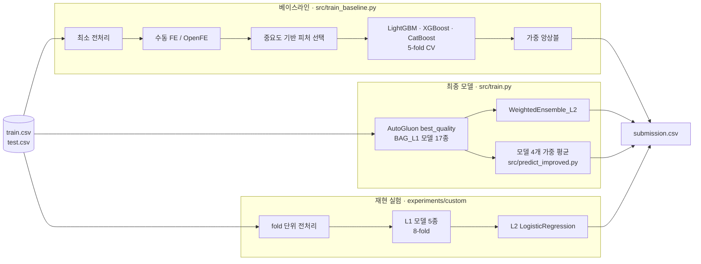

# FertileAI

**난임 시술 데이터로 임신 성공 여부를 예측한 해커톤 프로젝트의 개인 포트폴리오**

🏆 **DACON「난임 환자 대상 임신 성공 여부 예측 AI 해커톤」 2등** (6팀 참가, 최종 순위)
· Public LB ROC-AUC **0.74203** (AutoGluon)

> 원본 팀 레포: [kimyeongbin-dev/OZ-FertileAI](https://github.com/kimyeongbin-dev/OZ-FertileAI) (DACON Education × 오즈코딩스쿨, 2026.03.13 ~ 03.23)
>
> 이 레포는 팀 프로젝트에서 **본인이 작성한 코드와 실험**만 옮겨, 결과와 한계를 분석한 기록입니다.
> 팀원이 맡은 EDA, 전처리, CatBoost 앙상블 작업은 포함하지 않았습니다. `notebooks/`의 두 노트북은 본인이 전처리 결정을 위해 따로 작성한 것입니다.
>
> 원본 팀 레포에서 `Abbbs2ws`, `kimyeongbin-dev`, `Kimyeongbin` 이름의 커밋이 본인 계정입니다.
> 이 레포는 대회 후(2026.10) 정리한 이관 레포라 커밋 날짜가 이관 시점입니다. 대회 기간의 작업 기록은 원본 팀 레포에 있습니다.

---

## 프로젝트 개요

난임 시술 기록(환자 나이, 시술 유형, 배아·난자 수, 과거 시술·임신 이력 등)으로 해당 시술의 **임신 성공 확률을 예측**하는 DACON 해커톤 과제입니다. 성공 가능성을 예측해 환자와 의료진의 치료 의사결정을 돕는 것이 목표입니다.

| 항목 | 내용 |
|---|---|
| 데이터 | train 256,351건, test 90,067건, 피처 67개 (ID·타깃 제외) |
| 타깃 | 임신 성공 여부 (1: 성공, 0: 실패). 전체 시술 중 임신에 성공한 비율이 25.8%인 불균형 이진 분류 |
| 평가 지표 | ROC-AUC |
| 최종 성능 | Public LB **0.74203**, 최종 2등 (6팀 참가) |

**주요 작업**
- LightGBM·XGBoost·CatBoost 베이스라인과 수동·자동(OpenFE) 피처 엔지니어링 파이프라인
- AutoGluon `best_quality` 최종 모델 (Public LB 0.7420)
- AutoGluon의 bagging·스태킹 구조를 손으로 재현한 L2 스태킹 파이프라인

## 데이터에서 확인한 것

전처리 방향을 정하려고 [`notebooks/check.ipynb`](notebooks/check.ipynb)에서 확인한 내용입니다.

- **나이가 가장 강한 신호:** 시술 당시 나이별 성공률이 만18-34세 32.3%, 만35-37세 27.8%, 만38-39세 21.7%로 떨어지고 만43-44세는 11.8%입니다. 나이 순서가 성공률과 맞물려 있어, 범주가 아닌 순서형으로 인코딩했습니다.
- **결측 자체가 정보:** PGD·PGS·착상 전 유전 검사 컬럼은 약 99%가 결측이고, 값이 있으면 항상 1입니다. 결측은 "검사하지 않음"을 뜻하므로 결측을 0으로 보는 이진 플래그로 다루는 것이 맞다고 판단했습니다.
- **정보가 거의 없는 컬럼:** 전체가 0인 상수 컬럼 2개는 제거했습니다. 정자 기증자 나이도 기증 케이스(약 2.7만 건)에만 값이 있고 연령대별 성공률 차이가 4%p 남짓이라 제거 대상으로 봤습니다.

## 담당 역할

팀 3명 중 **모델링·AutoGluon·피처 엔지니어링**을 맡았습니다.

- 베이스라인 학습 파이프라인 설계 (CV, 모델 비교, 가중 앙상블, 제출 자동화)
- 피처 엔지니어링과 피처 선택 (도메인 파생 피처, OpenFE)
- AutoGluon 최종 모델 학습과 제출 (Public LB 0.7420)
- 수동 L2 스태킹 재현 실험과 회고

## 아키텍처



## 기술 스택 및 선정 이유

### 베이스라인 파이프라인

| 기술 | 선정 이유 |
|---|---|
| LightGBM · XGBoost · CatBoost | 정형 데이터에서 성능이 검증된 GBDT 세 가지를 같은 CV로 비교해 앙상블 후보를 고르기 위해. CatBoost는 범주형을 문자열 그대로 받을 수 있어 전처리를 모델별로 나눔 |
| 클래스 불균형 보정 (`is_unbalance`, `auto_class_weights`, `scale_pos_weight=2.87`) | 임신 성공이 25.8%, 실패가 74.2%로 불균형해, 모델마다 제공하는 가중 옵션으로 보정 (2.87 ≈ 74.2 / 25.8) |
| StratifiedKFold (5-fold) | 불균형 타깃의 비율을 fold마다 유지해 CV 점수가 흔들리지 않게 하기 위해 |
| OpenFE | 수작업 파생 피처 외의 조합을 자동으로 탐색하기 위해. GBDT 친화적 피처를 만들고, test 정보가 섞이지 않게 train으로만 fit. 생성이 느려 입력 해시 기준으로 결과를 캐시 |
| 중요도 기반 피처 선택 | 자동 생성으로 늘어난 피처 중 상위 k개만 남겨 과적합과 학습 시간을 줄이기 위해 |

### 최종 모델

| 기술 | 선정 이유 |
|---|---|
| AutoGluon `TabularPredictor` (`best_quality`) | GBDT·신경망·랜덤포레스트 등 여러 모델을 bagging으로 학습하고 가중 앙상블(`WeightedEnsemble_L2`)까지 자동으로 구성해, 수동 앙상블보다 넓은 조합을 같은 검증 기준으로 비교할 수 있음. 실제로 검증 AUC 0.7409로 단일 모델 최고(CatBoost 0.7403)보다 높았음 |
| 원본 피처 그대로 입력 | 베이스라인의 수동·자동 피처 대신 AutoGluon 자체 전처리에 맡김. 학습 스크립트는 ID 컬럼만 제거 |
| 학습 시간 12시간 (`time_limit=43200`) | `best_quality`는 시간을 많이 쓸수록 후보 모델이 늘어나므로, 대회 일정 안에서 한 번 돌릴 수 있는 최대 시간으로 설정 |

## 실험 결과

### 실험 흐름 (DACON 제출 기록 기준)

| 단계 | 방법 | 코드 | CV AUC | Public LB |
|---|---|---|---|---|
| 1 | LightGBM 단일 모델 | `src/train_baseline.py` | - | 0.7403 |
| 2 | CatBoost 단일 모델 | `src/train_baseline.py` | - | 0.7416 |
| 3 | CatBoost 6 : LightGBM 4 앙상블 | `src/train_baseline.py` | - | 0.7416 |
| 4 | 3 + OpenFE 자동 피처 + 피처 선택(상위 50개) | `src/train_baseline.py` | - | 0.7406 |
| 5 | AutoGluon `best_quality` (WeightedEnsemble_L2) | `src/train.py`* | 0.7409 | 0.7420 |
| 6 | **5의 모델 4개 가중 평균** | `src/predict_improved.py` | 0.7409 | **0.74204** |
| 7 | 수동 L2 스태킹 + seed bagging (재현 실험) | `experiments/custom/` | 0.7406 | 0.7419 |

- 최종 점수 0.74203은 6단계 제출(0.7420370)의 리더보드 표기값입니다.
- \* 대회 당시 학습은 데이터·출력 경로만 다른 이전 버전으로 실행했고, 학습 설정은 같습니다.
- 5단계 이후로는 모델 구성을 바꿔도 Public LB가 0.7419~0.7420에 머물렀습니다 (아래 분석 참고).
- 7단계는 AutoGluon이 내부에서 하는 일(fold 단위 전처리, OOF 스태킹)을 직접 구현해 거의 같은 점수를 재현한 실험입니다. 설계와 회고는 [`experiments/custom/docs/retrospective.md`](experiments/custom/docs/retrospective.md)에 있습니다.

### AutoGluon 모델별 검증 점수 (`results/autogluon/leaderboard.csv`)

| 모델 | 검증 AUC (`score_val`) | 학습 시간 |
|---|---|---|
| **WeightedEnsemble_L2** | **0.7409** | 전체 약 12시간 |
| CatBoost_BAG_L1 | 0.7403 | 1.9시간 |
| LightGBM_r131_BAG_L1 | 0.7398 | 3분 |
| XGBoost_BAG_L1 | 0.7390 | 2분 |
| NeuralNetTorch_r79_BAG_L1 | 0.7376 | 70분 |
| RandomForestEntr_BAG_L1 | 0.7313 | 1분 미만 |

`score_val`은 bagging OOF 기준 점수입니다.

## 한계점 및 분석

### 1. 피처 생성·선택을 CV 밖에서 수행

베이스라인은 OpenFE 피처 생성과 중요도 기반 피처 선택을 CV로 나누기 전에 전체 train의 타깃으로 수행했습니다. 검증 fold의 정답이 피처를 고르는 데 이미 쓰였으므로 CV가 낙관적으로 나옵니다. 실제로 이 조합을 더한 4단계는 Public LB가 3단계보다 0.001 낮았습니다. 이후 재현 실험(7단계)에서는 전처리 통계를 fold 안에서만 fit하도록 설계했습니다.

### 2. 학습 데이터로 계산한 리더보드·피처 중요도

AutoGluon 스크립트는 리더보드와 피처 중요도를 학습 데이터(`train_data`)로 계산합니다. 그래서 저장된 리더보드의 `score_test`는 학습 데이터 점수입니다(RandomForest 0.93 등). 모델 선택은 AutoGluon이 검증 점수로 하므로 제출에는 영향이 없지만, 분석할 때는 `score_val`만 봐야 합니다.

### 3. 최고점 제출의 개선 폭

6단계는 5단계 모델 중 4개를 손으로 정한 가중치로 평균한 제출입니다. Public LB는 0.00002 높았지만 CV는 같아서, 의미 있는 개선이라기보다 노이즈 범위의 차이로 봅니다.

### 배운 점

- GBDT 단일 모델, AutoGluon, 수동 스태킹이 모두 CV 0.739–0.741, Public 0.740–0.742에 모였습니다. 이 데이터에서는 모델 구성보다 데이터가 성능 상한을 정했고, 다음에 점수를 올리려면 도메인 기반 피처에 시간을 써야 합니다.
- 피처 생성·선택처럼 타깃을 쓰는 단계는 반드시 CV 안에서 수행해야 CV를 믿을 수 있습니다.

## AI 도구 활용

Claude Code를 페어 프로그래밍 도구로 활용해, 대회 중에는 학습 스크립트 실행·실험 반복 같은 반복 작업과 보일러플레이트 작성을, 대회 후에는 이 포트폴리오 레포 정리를 효율화했습니다.

- **직접 판단·검증한 일:** 실험 방향과 모델 선택, 제출할 결과 결정, 포함할 범위와 원본 코드의 동작을 바꾸지 않는다는 원칙, 문서에 담을 내용과 수치의 최종 확인

## 사전 요구사항

| 항목 | 내용 |
|---|---|
| Python | **3.13.12** |
| 최종 모델 | AutoGluon 1.5.0 (`autogluon.tabular`), PyTorch 2.9.1 |
| 주요 라이브러리 (실제 학습 환경) | pandas 2.3.3, numpy 2.1.3, scikit-learn 1.7.2, LightGBM 4.6.0, CatBoost 1.2.10, XGBoost 3.1.3 |
| 설치 | `requirements.txt`에 위 버전을 고정해 두었습니다 |
| 학습 시간 | 최종 모델 약 12시간 (`time_limit=43200`, 2026-03-15 01:55 → 13:56), 평가·예측까지 약 12.5시간 |
| OS | Windows (`metadata.json` 기준) |

버전은 AutoGluon이 학습할 때 기록한 [`results/autogluon/metadata.json`](results/autogluon/metadata.json) 기준입니다.

## 실행 방법 (참고)

### 데이터 준비

대회 규정상 원본 데이터는 레포에 포함하지 않습니다. [DACON 대회 페이지](https://dacon.io)에서 `train.csv`, `test.csv`를 받아 레포 루트의 `data/`에 둡니다. 베이스라인 스크립트와 노트북은 대회 당시 경로인 `datasets/`를 읽으므로, 이들을 실행할 때는 같은 파일을 `datasets/`에도 복사합니다.

### 설치

```bash
./scripts/setup.sh          # Windows: ./scripts/setup.ps1
pip install -r requirements.txt
```

### 최종 모델 (`src/train.py`)

레포 루트에서 실행하며, `data/train.csv`, `data/test.csv`를 읽습니다.

```bash
python src/train.py            # best_quality, 약 12시간
```

결과: 모델 `models/autogluon_models/`, 제출 파일 `submission/submission.csv`, 리더보드·피처 중요도·로그 `output/` (모두 `.gitignore` 대상). 대회 당시 결과 중 작은 파일만 [`results/autogluon/`](results/autogluon/)에 보관했습니다.

### 베이스라인 파이프라인 (`src/train_baseline.py`)

코드는 대회 당시 상태 그대로이며, `src/`에서 실행하고 데이터를 `datasets/`에서 읽습니다.

```bash
cd src
python train_baseline.py                                              # LGBM·XGB·CatBoost CV 비교
python train_baseline.py --model ensemble --submit                    # CatBoost 6 : LGBM 4 앙상블
python train_baseline.py --model ensemble --auto-fe --submit          # + OpenFE 자동 피처
python train_baseline.py --model ensemble --auto-fe --feature-select --submit  # + 피처 선택(상위 80개)
```

결과는 `outputs/<prefix>_<시각>/`, OOF 예측은 `outputs/oof_cache/`, OpenFE 결과는 `cache/openfe/`에 저장됩니다 (모두 `.gitignore` 대상).

### 수동 스태킹 (`experiments/custom/`)

```bash
cd experiments/custom
mkdir -p data && cp ../../data/train.csv ../../data/test.csv data/
python src/test_pipeline.py     # 스모크 테스트
python src/pipeline.py          # 또는 src/pipeline_bagging.py, GPU 기준 약 1h 45m
```

CatBoost·XGBoost는 GPU 설정이므로, GPU가 없으면 `src/config.py`에서 CPU로 바꿉니다.

### 참고: 실험 코드의 경로

최종 모델 `src/train.py`와 `experiments/custom/`은 이 레포 구조에 맞습니다. 나머지 실험 코드는 대회 당시 상태 그대로라 팀 레포의 폴더 구조를 전제로 합니다.

| 대상 | 필요한 조정 |
|---|---|
| `src/train_baseline.py`, 노트북 | `src/`(노트북은 `notebooks/`)에서 실행하고, 데이터를 `datasets/`에 둠 |
| `src/predict_improved.py` 등 03-15 모델을 쓰는 스크립트 | 모델 경로 `./archive/autogluon/output/autogluon_models`를 실제 위치로 지정 |

## 프로젝트 구조

```
FertileAI/
├── src/
│   │   # 베이스라인
│   ├── preprocessing_baseline.py     # 최소 전처리 (ID·상수 제거, 횟수·나이 인코딩)
│   ├── feature_engineering.py        # 수동 파생 피처 (비율·합계·플래그·교차)
│   ├── auto_feature_engineering.py   # OpenFE 자동 피처 생성 + 캐시
│   ├── feature_selection.py          # 저중요도 제거 / LGBM 중요도 상위 k개 선택
│   ├── train_baseline.py             # 진입점: CV 학습, 모델 비교, 가중 앙상블, 제출 파일 생성
│   │   # 최종 모델 (AutoGluon)
│   ├── train.py                      # 진입점: AutoGluon best_quality 학습과 제출
│   ├── predict_improved.py           # 학습된 모델 4개 가중 평균 (최종 점수 제출)
│   ├── validate_ensemble.py          # OOF로 가중치 조합 비교
│   ├── train_improved.py             # RF·XT 제외, 10-fold, 14시간 재학습
│   └── pseudo_labeling.py            # pseudo label 재학습 실험
├── notebooks/
│   ├── eda.ipynb                     # 분포·결측·타깃 상관 분석
│   └── check.ipynb                   # 전처리 결정 근거 확인
├── experiments/custom/               # 수동 L2 스태킹 재현 실험 (코드·설계 문서·회고)
├── results/
│   └── autogluon/                    # 대회 당시 리더보드, 피처 중요도, 학습 환경(metadata.json)
├── scripts/                          # 클론 직후 셋업 (훅 연결, 데이터 확인)
├── .githooks/                        # commit-msg, pre-push
└── requirements.txt
```


## 개발 규칙

커밋 컨벤션, 브랜치 전략, Git 훅은 [CONTRIBUTING.md](CONTRIBUTING.md)를 따릅니다.
